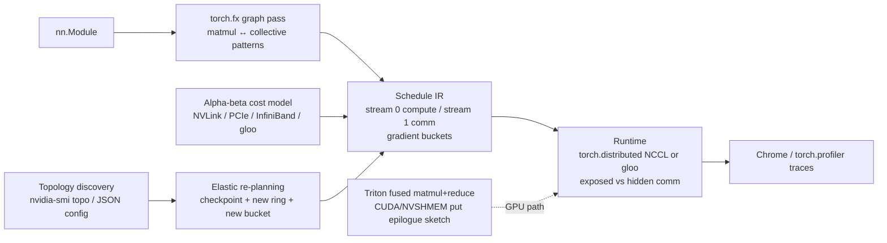

# nccl-fusion-sched (`ncclfuse`)

## Problem

In distributed training/inference, collectives (all-reduce, all-gather,
reduce-scatter, MoE all-to-all) sit on the critical path next to matmuls.
Launched naively they are fully *exposed*: the GPU/CPU idles while bytes move.
NCCL and NVSHMEM solve the transport; frameworks still have to decide **when**
to launch each collective, **how big** each gradient bucket is, **which
stream/tier** it runs on, and **what to do when a rank dies**. `ncclfuse` is a
small, testable take on that scheduling layer for PyTorch.

## Architecture



## Components

| Piece | File |
|---|---|
| fx pattern matcher + bucketing/stream lowering, traceable collective markers | `ncclfuse/graph_pass.py` |
| Schedule IR (printable, JSON round-trip, validated) | `ncclfuse/schedule.py` |
| Runtime: process-group init, overlap measurement, schedule execution | `ncclfuse/runtime.py` |
| Alpha–beta cost model (ring/tree × NVLink/PCIe/IB/Ethernet/gloo), bucket sizing | `ncclfuse/cost_model.py` |
| Topology discovery, greedy tier-aware ring, checkpoint + failure re-plan | `ncclfuse/elastic.py` |
| Chrome-trace export / `torch.profiler` capture | `ncclfuse/profiling.py` |
| Triton fused matmul + reduce epilogue (GPU-gated, CPU-safe import) | `ncclfuse/kernels_triton.py` |
| NVSHMEM one-sided `put` matmul epilogue sketch (not built by pip) | `csrc/matmul_nvshmem.cu` |
| Toy-transformer benchmark, 2–8 ranks | `benchmarks/bench_toy_transformer.py` |

## Quickstart

```bash
python3 -m venv .venv && . .venv/bin/activate
pip install -e '.[dev]'          # CPU torch is fine; GPU torch + Triton unlock kernels
pytest -q                        # includes a 2-rank gloo end-to-end test
python benchmarks/bench_toy_transformer.py --ranks 2 --steps 10
```

```python
import ncclfuse as nf
sched = nf.schedule_module(model, world=2, tier="nvlink")  # or "gloo_cpu"
print(sched)                       # stream-assigned, bucketed Schedule IR
print(nf.collective_time("all_reduce", 1 << 24, world=8, tier="infiniband"))
```

## Results

Actual run on the development laptop (Apple Silicon, no GPU), 2026-11-15,
`benchmarks/bench_toy_transformer.py --ranks 2 --steps 10`:

| ranks | mode | step (ms) | comm hidden % | device |
|---|---|---|---|---|
| 2 | no_overlap | 7.96 | 0.0 | CPU/gloo |
| 2 | overlap | 6.50 | 4.1 | CPU/gloo |

Read this honestly: on CPU/gloo the "compute" available to hide behind is
small and gloo collectives are latency-bound over loopback, so only ~4% of
communication is hidden even though wall-clock improves (thread wake-up and
copy costs also move off the critical path). The same benchmark on GPU/NCCL
(`--ranks 2..8`) reports the GPU numbers instead — expect hidden % to rise
with larger buckets and real NVLink/IB bandwidth. No GPU numbers are claimed
here because none were measured.

## Design tradeoffs

- **Bucketing vs latency.** Bigger gradient buckets amortise per-collective
  latency (`alpha`) and reach peak bandwidth, but delay the first bucket until
  more gradients are ready and inflate the exposed tail. The cost model picks
  the largest power-of-two bucket whose predicted time fits the compute window.
- **One-sided vs two-sided.** Two-sided collectives (NCCL all-reduce) are
  simple and fast for dense reductions but synchronise every peer. One-sided
  NVSHMEM `put`+signal (see `csrc/`) lets a producer push a tile and lets the
  consumer wait only when it needs that tile — better tail behaviour for
  tensor-parallel epilogues, at the price of symmetric-memory management and
  explicit fences/signals.
- **CUDA Graphs.** Capturing a scheduled step removes launch overhead and
  freezes the overlap plan, but requires static shapes/addresses and must be
  re-captured after any elastic resize. Hence `cuda_graph` is a flag on the
  schedule, only honoured when CUDA is actually present.
- **Overlap mechanism.** CUDA uses a separate comm stream; CPU/gloo uses a
  thread (gloo releases the GIL while waiting). Same IR, two executors.

## Limitations

- fx byte counts assume fp32 unless shapes are propagated; MoE all-to-all is
  pattern-matched and scheduled, not load-balanced.
- The Triton kernel and NVSHMEM sketch are GPU-only and untested in CI (no GPU
  runner); CPU paths skip them cleanly.
- Ring planning is greedy by link tier, not an optimal topology solver.
- Elastic recovery restores rank-agnostic checkpoint state and re-plans; it
  does not do live process-group surgery (that needs a rendezvous service).
- Cost model is analytical alpha–beta — calibrate `TIERS` from measured busBW
  before trusting absolute numbers.

## License

MIT — see `LICENSE`.
